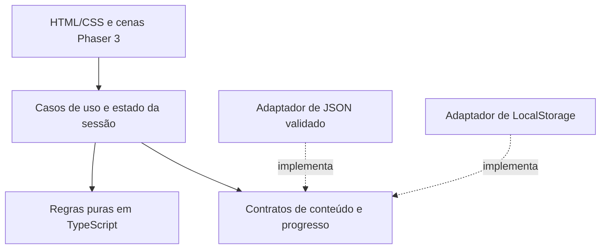
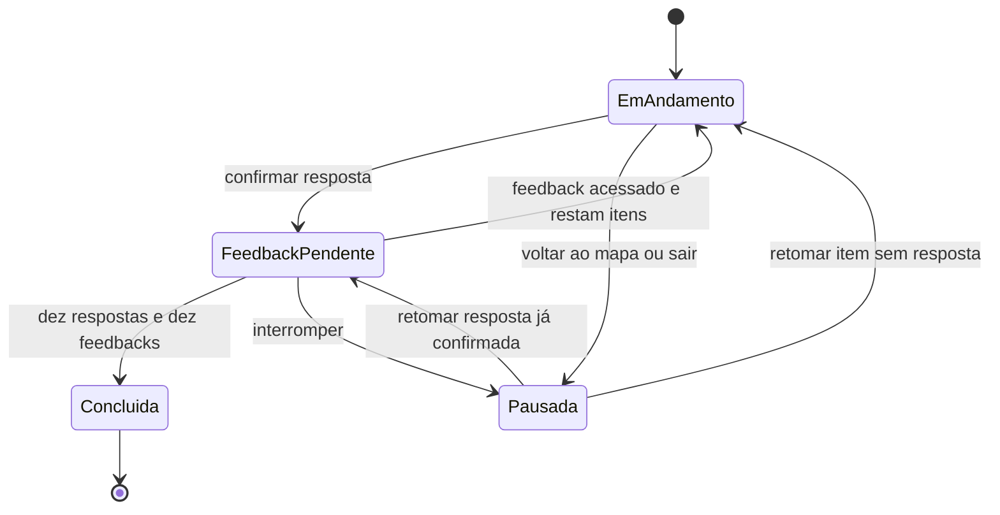

# Nexus — Jornada Digital — arquitetura do projeto

Versão 1.1 • Posicionamento atualizado em 13/11/2026 • Base técnica preservada; demonstração funcional 0.2.0.

## 0. Identidade e origem pedagógica — atualização de 13/11/2026

A identidade visível é **Nexus — Jornada Digital**, uma experiência permanente e lúdica de desenvolvimento de competências em tecnologia. Esta decisão substitui o posicionamento anterior de preparação para uma edição de avaliação. A visão vigente está em [visao-do-jogo.md](visao-do-jogo.md); as fontes históricas permanecem em `docs/fontes`.

A primeira coleção pedagógica interna terá o identificador **`enade-2026`**, baseada nas competências e referências do ENADE. A origem é mantida para rastreabilidade interna, sem ENADE, preparação, prova ou simulado na interface principal. PPCs, disciplinas, nivelamento, projetos e certificações são futuras origens de coleções, ainda não implementadas.

`src/config/game.ts` centraliza nome, subtítulo, metadados HTML, títulos e textos principais. Vistas e shell consomem essa configuração. O plugin de identidade em `vite.config.ts` usa os mesmos valores no HTML inicial, inclusive sem JavaScript. `src/config/collections.ts` registra a coleção interna planejada e não é importado pela interface.

O vocabulário visível é desafio, missão, missão especial, pontuação, relatório da missão e laboratório de treinamento. Os nomes de capacidades futuras não criam novos fluxos nesta refatoração. Classes e componentes usam nomes genéricos, sem origem de coleção no nome; Mission, Challenge, LearningTrack, ChallengeCollection, QuestionChallenge e PuzzleChallenge são exemplos para evoluções. GameSession, QuestionScene e ResultScene continuam neutros e compatíveis.

**Compatibilidade:** não mudar pontuação, filtragem, confirmação, progressão, JSON de desafios, schemas, IDs, versões ou armazenamento. O pacote e a pasta técnica `missao-enade`, bem como a chave `missao-enade:example-result:v1`, continuam internos. Relatórios gravados antes da mudança devem continuar legíveis, sem migração ou perda de dados.

A missão atual continua demonstrativa e usa `FASE-EXEMPLO-01` / `example-1`; a coleção editorial `enade-2026` permanece planejada. A arquitetura de MVP abaixo conserva rastreabilidade, restrições e critérios editoriais. Referências ao exame nesse material são contexto interno, não texto a reproduzir na interface.


## 1. Escopo e decisões

Jogo educacional 2D de navegador, para computador e celular, situado na cidade digital Nexo. O estudante seleciona um curso, acessa a Central Nexo, resolve dez questões, recebe explicações e acompanha sua evolução. Não há tempo limite, vidas, punição por erro ou nota mínima para concluir.

| Perfil | Denominação |
| --- | --- |
| CC | Ciência da Computação |
| SI | Sistemas de Informação |
| TADS | Tecnologia em Análise e Desenvolvimento de Sistemas |
| TGTI | Tecnologia em Gestão da Tecnologia da Informação |
| TRC | Tecnologia em Redes de Computadores |

**MVP:** tela inicial; seleção dos cinco cursos; mapa com dez terminais; somente `FASE-COMUM-01`; dez questões autorais de cinco alternativas e uma correta; confirmação; feedback de todas as alternativas; pontuação; resultado; três conquistas; revisão de erros; salvamento e retomada local; acessibilidade e layout responsivo.

**Depois do MVP:** fases específicas, questões equivalentes, revisão espaçada, exportação/importação e instalação offline. Sem servidor, conta, sincronização, ranking público, APIs pagas ou IA durante a partida. Ferramentas de desenvolvimento podem auxiliar a autoria, mas nenhum serviço de IA integra o executável.

### Base documental e precedência

Foram utilizados os anexos `visao-do-jogo(3).md` (v0.2), `referencias-enade-2026-v2(2).md` (v2), `matriz-pedagogica.md`, `distribuicao-inicial-questoes.md` e `areas.json` (schema 1.0.0). Os nomes anteriores citados dentro da matriz e do JSON são referências históricas dos documentos; não significam anexos adicionais consultados.

A visão governa mecânica, narrativa e pontuação. A matriz e o JSON refinam a elegibilidade pedagógica e os slots: a fase universal passa a sete itens de Formação Geral e três de fundamentos técnicos. Algoritmos, programação, estruturas, banco e requisitos da amostra antiga não serão forçados para todos os cursos. A pesquisa fornecida governa o recorte normativo registrado, sem reproduzir aqui calendário ou regras individuais de habilitação. Não foi feita nova auditoria normativa nesta arquitetura.

Os anexos registram **39 áreas, 111 questões planejadas e 60 slots nas seis primeiras fases**, mas **zero questões completas ou validadas**. Dez slots pertencem ao MVP; as outras fases são planejamento. “Área confirmada” não significa “questão aprovada”. O piloto depende de revisão docente dos dez itens pelos cinco cursos. O jogo é independente e sua pontuação não estima nota oficial ou domínio de uma área.

## 2. Arquitetura e limites dos módulos

Aplicação estática com regras de domínio em TypeScript, conteúdo JSON empacotado e apresentação híbrida: Phaser 3 para cenário, mapa e transições; HTML/CSS para todo texto e controle necessário à partida. Não usar framework de UI no MVP.



| Camada | Responsabilidade | Limite |
| --- | --- | --- |
| Domínio | Tipos, elegibilidade, tentativas, pontuação, revisão e conquistas | Não importa Phaser, DOM, LocalStorage ou bibliotecas de teste |
| Aplicação | Iniciar/retomar tentativa, confirmar resposta, registrar feedback, concluir, revisar, trocar curso | Único caminho para mutações; chama portas de repositório |
| Conteúdo | Carregar JSON, validar schema e relações, criar índices por ID | Não calcula progresso nem decide pontuação |
| Infraestrutura | Serialização, migrações, acesso ao armazenamento, relógio e geração de ID | Implementa contratos; erros não derrubam a partida |
| Apresentação | Cenas, vistas DOM, foco, anúncio de feedback e mapa | Envia comandos; renderiza estado retornado, sem recalcular regras |

Um `GameSession` em memória é criado no bootstrap e recebe repositórios por injeção simples. As cenas recebem essa dependência; o registry do Phaser, se usado, guarda apenas sua referência. Não existem cópias independentes de pontuação em cenas. Eventos tipados notificam `answerConfirmed`, `feedbackAccessed`, `attemptCompleted`, `reviewAnswered` e `saveStatusChanged` depois da atualização de estado. Cancelar listeners, observers e vistas no encerramento de cada cena.

Contratos previstos: `ContentRepository` (catálogo e versões por ID), `ProgressRepository` (load/save/reset), `Clock` e `IdGenerator`. Funções puras como `isEligible`, `calculateScore` e `evaluateAchievements` podem ser testadas sem navegador. Não adotar ECS, microsserviços ou motor de física: seleção direta dos terminais é suficiente.

### Ferramentas

- Phaser **3**, sem migração implícita para Phaser 4; fixar uma versão 3.x validada no início da implementação.
- TypeScript com `strict`; Vite para desenvolvimento e pacote estático; HTML semântico e CSS mobile first.
- JSON Schema + Ajv como proposta única de validação em runtime/build; os tipos TS e schemas devem ter teste de contrato para evitar divergência.
- Vitest para domínio, persistência e DOM; ambiente DOM simulado para vistas; Playwright para integração real entre DOM, canvas e navegador; axe-core como apoio à auditoria de acessibilidade.
- ESLint, verificação de tipos e lockfile versionado. Selecionar versões mutuamente compatíveis e registrar Node suportado em `.nvmrc`/`engines` na primeira entrega; não depender de `latest` no CI.

JSON e assets serão incluídos no pacote de build por imports locais e URLs resolvidas pelo Vite. Nada depende de CDN, fontes remotas ou chaves secretas. Acesso a referências externas é opcional e não condiciona responder.

## 3. Estrutura de pastas proposta

Árvore de destino, ainda não implementada:

```text
missao-enade/
  docs/
    arquitetura.md
    backlog.md
    fontes/                     # cópias preservadas dos anexos, na implementação
  public/
    favicon.svg
  src/
    main.ts
    app/
      bootstrap.ts
      GameSession.ts
      commands/
      events.ts
    domain/
      models/
        Course.ts
        Question.ts
        Area.ts
        StudentProfile.ts
        Attempt.ts
      eligibility.ts
      scoring.ts
      progression.ts
      achievements.ts
      review.ts
    ports/
      ContentRepository.ts
      ProgressRepository.ts
      Clock.ts
      IdGenerator.ts
    infrastructure/
      content/
        JsonContentRepository.ts
        validateContent.ts
      storage/
        LocalStorageProgressRepository.ts
        migrations/
      system/
    game/
      config.ts
      scenes/
        BootScene.ts
        PreloadScene.ts
        HomeScene.ts
        CourseSelectScene.ts
        MapScene.ts
        QuestionScene.ts
        ResultScene.ts
        ReviewScene.ts
      objects/
        Terminal.ts
    ui/
      AppShell.ts
      views/
      components/
      focus.ts
      announcements.ts
    styles/
      tokens.css
      base.css
      layout.css
      components.css
    content/
      manifest.json
      courses.json
      areas.json
      sources.json
      phases.json
      achievements.json
      questions/
        central-nexo.json
    schemas/
      question.schema.json
      area.schema.json
      phase.schema.json
      progress.schema.json
    assets/
      images/
      audio/
  tests/
    unit/
    integration/
    e2e/
    fixtures/                   # itens sintéticos, nunca publicados como aprovados
  scripts/
    validate-content.ts
  .github/workflows/
    ci.yml
    deploy.yml
  index.html
  package.json
  package-lock.json
  tsconfig.json
  vite.config.ts
  vitest.config.ts
  playwright.config.ts
```

Organizar questões por coleção editorial, nunca criar uma cópia por curso. `courses.json` contém sigla, nome, descrição e região futura. `sources.json` preserva os IDs F04–F10 usados no material pedagógico e suas evidências; novas referências recebem IDs próprios. O manifesto identifica `contentVersion`, versões de schemas e arquivos. O `areas.json` editorial fornecido continua como fonte preservada; uma transformação explícita produz o catálogo operacional, sem descartar evidências docentes.

## 4. Cenas do Phaser e fluxo

| Cena | Função e vista HTML | Saídas |
| --- | --- | --- |
| BootScene | Instancia dependências, consulta save e preferências; apresenta erro recuperável | Preload |
| PreloadScene | Carrega recursos locais e valida conteúdo; progresso e opção de tentar novamente | Home ou tela de conteúdo indisponível |
| HomeScene | Título, introdução opcional, iniciar/continuar, preferências e apagar progresso | Seleção ou retomada |
| CourseSelectScene | Cinco opções com nomes por extenso; confirma curso | Mapa |
| MapScene | Central Nexo com dez terminais e lista HTML equivalente; revisão e resumo local | Questão, revisão ou resultado |
| QuestionScene | Enunciado, alternativas, confirmar, feedback e próximo terminal | Outra questão, mapa ou resultado |
| ResultScene | Acertos iniciais, pontos, tentativas, conquistas, pendências e repetir | Mapa, revisão ou nova tentativa |
| ReviewScene | Fila de erros, nova resposta sem solução prévia e feedback; sair sem perda | Próximo erro ou mapa/resultado |

Feedback é um estado da `QuestionScene`, não uma cena paralela que grava outra resposta. Preferências e confirmação de exclusão são vistas DOM do shell, não cenas adicionais. Uma cena de conteúdo fica ativa por vez. Nenhuma alteração de cena representa por si só um acerto ou conclusão.



O comando de confirmação trava a resposta inicial daquele item. Ao carregar a vista de feedback com sucesso no DOM, registrar `feedbackAccessedAt`; isso comprova apresentação, não leitura. Se houver interrupção entre resposta e feedback, a retomada reapresenta o feedback, sem permitir outra resposta inicial. Seleção ainda não confirmada pode ser descartada na saída. Revisão usa registros separados e não reabre uma tentativa concluída.

## 5. Modelo de questões

Uma questão é uma entidade independente, identificada por `id` estável e `version` inteira. A associação muitos-para-muitos com cursos fica em `courses`. Fases referenciam `{questionId, questionVersion}`: nunca embutem cópias de enunciados. Diferentes questões sobre o mesmo tema são legítimas quando objetivo ou contexto mudam; duplicar a mesma questão apenas para mudar o curso é proibido.

Contrato conceitual, a converter em schemas na implementação:

| Campo | Tipo / regra |
| --- | --- |
| `id`, `version` | String estável globalmente única e inteiro positivo |
| `type` | `single-choice` no MVP |
| `courses` | Lista não vazia, sem duplicatas, subconjunto de CC/SI/TADS/TGTI/TRC |
| `primaryAreaId` | Uma área principal para contagem, estatísticas e distribuição |
| `secondaryAreaIds` | Outras áreas realmente avaliadas, sem repetir a principal |
| `objective`, `projectCompetencyId` | Objetivo observável e competência interna do jogo; não inventar códigos oficiais |
| `difficulty` | D1, D2 ou D3, estimativa editorial |
| `context`, `prompt` | Blocos estruturados: parágrafo, lista, tabela, código ou imagem com descrição |
| `options` | Exatamente cinco objetos `{id, blocks}`; IDs estáveis A–E no MVP |
| `correctOptionId` | Exatamente um ID existente em `options` |
| `feedback` | `{summary, concept, byOption}`; justificativa não vazia para cada A–E |
| `references` | IDs de fontes e localizadores; URLs resolvidas em `sources.json` |
| `tags` | Temas auxiliares; não concedem elegibilidade |
| `editorialStatus` | `draft`, `in-review`, `approved` ou `retired` |
| `teacherReviews` | Curso, referência local do parecer, data, versão revisada e decisão |
| `equivalentGroupId` | Opcional; reservado para itens de transferência posteriores |

Exemplo de metadados **incompleto, não publicável**, sem redigir uma questão nesta etapa:

```json
{
  "id": "Q-NEXO-08",
  "version": 1,
  "type": "single-choice",
  "courses": ["CC", "SI", "TADS", "TGTI", "TRC"],
  "primaryAreaId": "COMUM-TEC08",
  "secondaryAreaIds": [],
  "objective": "Diagnosticar falha básica de comunicação por evidências, sem configurar protocolo.",
  "projectCompetencyId": "NEXO-DIAGNOSTICAR",
  "difficulty": "D1",
  "references": [{"sourceId": "F10", "locator": "Recorte registrado na matriz; completar evidências dos demais cursos"}],
  "editorialStatus": "draft",
  "teacherReviews": []
}
```

O exemplo omite enunciado, alternativas e feedback de propósito. O schema de publicação rejeita esse estado. Fixtures de teste terão conteúdo sintético completo, separado do banco aprovado.

### Integridade editorial

Validar sintaxe e relações no CI e na carga: IDs únicos; áreas e fontes existentes; cinco alternativas; gabarito válido; todas as justificativas; acessibilidade dos blocos; cursos compatíveis com **cada área efetivamente avaliada**. No MVP, `question.courses` deve ser subconjunto da interseção de `cursos_relacionados` dessas áreas. Tags de contexto sem cobrança não entram como áreas secundárias. Combinações novas exigem revisão da matriz, não uma exceção silenciosa no filtro.

Uma questão aprovada só pode ser distribuída nos cursos com parecer de aprovação para sua versão atual. Em questão universal, exigir os cinco cursos; aprovação anterior não autoriza versão alterada. Mudança de texto, gabarito, objetivos ou elegibilidade gera nova versão. Conservar versões referenciadas por saves compatíveis; se uma versão tiver erro conceitual, retirá-la da prática e avisar na retomada. Não corrigir nota antiga silenciosamente.

Renderizar texto como texto, com templates controlados para blocos; não aceitar HTML arbitrário nem executar código contido no enunciado. Diagramas precisam de alternativa textual suficiente, e tabelas usam legenda e cabeçalhos semânticos.

## 6. Modelo das áreas e das fases

Preservar a semântica do `areas.json` fornecido. Área é recorte pedagógico, não uma pasta de questões nem uma credencial do estudante.

| Campo editorial existente | Uso operacional |
| --- | --- |
| `codigo`, `nome`, `categoria` | ID, rótulo e categoria COMUM ou trilha |
| `cursos_relacionados` | Cursos sustentados; COMUM não significa todos |
| `competencia`, `habilidade`, `assuntos` | Objetivos e vínculos pedagógicos |
| `prioridade`, `dificuldade` | Planejamento e dificuldade estimada; não pesos de pontuação |
| `pre_requisitos` | Sugestões de estudo, sem bloqueio por nota |
| `fonte_oficial`, `evidencias_por_curso` | Rastreabilidade das associações |
| `situacao`, `escopo_situacao` | Estado do alinhamento documental |
| `validacao_docente`, `situacao_itens` | Estado editorial, separado do alinhamento |
| `quantidade_inicial_questoes`, `fase_inicial` | Metas de autoria e slots; não inventário de itens prontos |

O catálogo de runtime pode projetar esses campos, mas deve manter acesso às evidências em material editorial. Retirar campos de planejamento do bundle é otimização futura, sem perda da fonte.

Uma fase publicada contém `id`, `version`, `name`, `regionId`, `courses`, `status` e dez `slots` ordenados. Cada slot contém `slotId`, `areaId`, `questionId` e `questionVersion`. O planejamento original tem somente objetivos: a associação a uma questão só será preenchida depois de autoria e revisão. A aplicação verifica todos os slots antes de criar a tentativa. Não reduzir para nove questões nem incluir um item incompatível para preencher vaga.

| Slot MVP | Área principal | Foco resumido |
| --- | --- | --- |
| NEXO-01 | COMUM-FG04 | Dados de acesso à educação |
| NEXO-02 | COMUM-FG01 | Informação pessoal, direitos e responsabilidade |
| NEXO-03 | COMUM-FG05 | Comunicação digital e contexto cultural |
| NEXO-04 | COMUM-FG03 | Intervenções socioambientais |
| NEXO-05 | COMUM-FG01 | Trabalho e cidadania |
| NEXO-06 | COMUM-FG06 | Cooperação científica e inovação |
| NEXO-07 | COMUM-FG02 | Barreiras e acessibilidade |
| NEXO-08 | COMUM-TEC08 | Comunicação em redes |
| NEXO-09 | COMUM-TEC07 | Recursos do sistema operacional |
| NEXO-10 | COMUM-TEC09 | Proteção da informação |

Todos são D1 no planejamento e serão os mesmos dez itens nos cinco cursos. Manter a ordem fixa de itens e alternativas no MVP facilita retomada e diagnóstico. Sorteio é expansão; se adotado, a ordem escolhida será persistida.

## 7. Filtragem por curso sem duplicação

A elegibilidade é calculada por ID, nunca pelo prefixo do nome ou apenas pela categoria COMUM:

1. Verificar curso reconhecido e fase publicada para esse curso.
2. Resolver as versões exatas das questões de cada slot.
3. Exigir status aprovado, curso presente em `question.courses`, compatibilidade de áreas e parecer docente vigente daquele curso.
4. Eliminar referências repetidas ao mesmo ID na fase e validar a distribuição planejada.
5. No MVP, exigir dez itens elegíveis **para cada um dos cinco cursos** e os mesmos IDs. Falha bloqueia o release; em runtime apresentar indisponibilidade e retorno à seleção, sem fallback curricular.

Exemplos: `COMUM-TEC10` atende CC, SI, TADS e TGTI; não será liberada a TRC automaticamente. `COMUM-TEC08` pode atender todos, mas uma questão avançada de roteamento não se torna universal só por citar redes. Itens de CC-01 só entram em CC enquanto a matriz e os pareceres não sustentarem outro vínculo.

Trocar curso fora de uma tentativa não clona conteúdo. A tentativa captura o curso de início e não muda com preferências posteriores. No MVP, a única fase comum tem um histórico compartilhado por perfil; mudar de CC para TRC preserva a conclusão, os erros e as conquistas, sem atribuir um novo acerto. Futuras fases específicas terão históricos por fase e seu escopo de curso. Não trocar curso dentro da questão: voltar ao mapa primeiro.

## 8. Perfil do estudante e estado salvo

MVP: um perfil anônimo por navegador/origem, sem login e sem identificação acadêmica. Os cinco cursos são opções de percurso, não cinco contas. Não coletar nome civil, matrícula, e-mail ou elegibilidade individual.

```json
{
  "id": "perfil-local",
  "selectedCourse": "SI",
  "createdAt": "2026-11-12T15:00:00.000Z",
  "preferences": {
    "soundEnabled": false,
    "reducedMotion": true,
    "textScale": 1,
    "highContrast": false
  }
}
```

Valores ilustrativos. Respeitar inicialmente `prefers-reduced-motion`, com escolha explícita persistida. Horários são ISO UTC; interface formata no fuso do dispositivo. Datas não concedem bônus e relógio alterado não muda pontos.

Envelope de progresso previsto:

| Campo | Conteúdo |
| --- | --- |
| `schemaVersion` | Inteiro do formato persistido, independente do conteúdo |
| `contentVersion` | Versão do catálogo usada na gravação |
| `revision`, `updatedAt` | Controle de gravação e diagnóstico de conflitos |
| `profile` | Perfil e preferências |
| `activeAttemptId` | Tentativa incompleta atual ou null |
| `attempts` | Histórico limitado de tentativas |
| `reviewEntries` | Pendências e respostas de revisão |
| `achievementUnlocks` | IDs de selos, data e tentativa de origem |
| `summaries` | Contadores compactos, primeiro/melhor resultado e evidência de contato prévio |

`Attempt` contém `id`, `phaseId`, `phaseVersion`, `courseAtStart`, `contentVersion`, `mode: learning`, `status`, início/fim, dez referências ordenadas de questões, `currentSlotId` e respostas. Cada resposta guarda `questionId`, `questionVersion`, `selectedOptionId`, `isCorrect`, `confirmedAt` e `feedbackAccessedAt` ou null. Registrar também IDs já conhecidos no início da tentativa para informar contato prévio. Pontuação é derivada das respostas, nunca de incrementos em um contador livre.

Revisão: chave lógica `(attemptId, questionId, questionVersion)`, `status: pending | correct-in-review`, histórico limitado de respostas e data do último acerto. Revisar um item sem erro inicial permite ler explicações, mas não cria erro ou altera conquistas. Nova tentativa que erre a mesma questão gera nova pendência vinculada àquela tentativa; a interface pode agrupar por questão, preservando os vínculos originais. Não afirmar domínio por repetição.

## 9. Armazenamento e retomada

Usar `localStorage` na chave com namespace `missao-enade:progress:v1`, com backup `missao-enade:progress:backup` e marcador temporário `missao-enade:progress:pending`. O envelope também tem `schemaVersion`: o nome da chave não substitui migrações. LocalStorage guarda strings por origem; HTTP/HTTPS, domínio e navegador diferentes não compartilham progresso [T4].

### Gravação

1. O caso de uso valida o comando e produz o novo estado em memória.
2. Serializa e valida o envelope completo; grava `pending`.
3. Preserva como backup o último envelope principal válido; substitui a chave principal em uma única chamada `setItem`.
4. Limpa `pending`; publica o estado e o status do salvamento para a UI.

As várias chaves não constituem uma transação. A chave principal válida é autoritativa: um `pending` remanescente só é candidato a recuperação quando a principal estiver ausente/inválida e após validação. Não promover um `pending` silenciosamente sobre uma principal válida.

Salvar em cada resposta confirmada, apresentação de feedback, resposta de revisão, conclusão e mudança de preferências/curso. Não aguardar `beforeunload`. Confirmação e fechamento da fase são idempotentes por tentativa + questão; duplo toque, Enter repetido e eventos duplicados não geram novos pontos ou novas conquistas.

### Falhas e versões

- Envolver leitura e gravação em `try/catch`, inclusive `SecurityError` e falta de quota. Se falhar, manter a sessão em memória e exibir “Progresso não salvo neste navegador”, com tentar novamente. Não afirmar que a retomada está garantida.
- Carregar com parse e schema; validar invariantes e referências. Se a principal estiver corrompida, oferecer restaurar backup válido ou iniciar de novo; não apagar tudo silenciosamente.
- Migrações são funções puras sequenciais, com fixtures de versões antigas; só substituir a principal depois de validar a migração. Versão futura desconhecida abre aviso e não é sobrescrita automaticamente.
- Mudança de conteúdo não deve combinar resposta antiga com gabarito novo. Se uma versão exata não existir ou estiver retirada, encerrar a retomada como incompatível, preservar resumo histórico e oferecer nova tentativa com conteúdo atual. Revisões incompatíveis ficam identificadas como indisponíveis.
- Limitar a dez tentativas detalhadas por fase e cem respostas recentes de revisão por perfil; preservar tentativa ativa, pendências de erro, primeiro/melhor resumo e selos ao compactar. Até existirem fases novas, isso é pequeno. Meta de envelope principal abaixo de 500 KiB; medir incluindo cópias temporárias. Nunca prometer quota universal.
- Suportar uma aba escritora. Evento `storage` com revisão diferente pausa a edição na outra aba e pede recarregar; antes de gravar, conferir a revisão esperada. Isso reduz conflitos, mas não é trava transacional entre abas; cenário de edição simultânea não é suportado no MVP.
- “Apagar progresso” tem confirmação explícita e remove apenas chaves `missao-enade:*` e estado em memória; nunca chamar `localStorage.clear()`. Preferências também são apagadas, conforme aviso.

Dados podem ser modificados pelo usuário e gabaritos fazem parte do pacote: recurso formativo, sem antifraude ou uso como avaliação de alto impacto. Limpeza do navegador, modo privado e troca de origem/dispositivo podem perder dados. Não há sincronização. Exportação/importação segura fica no backlog posterior.

## 10. Pontuação, progressão e conquistas

`pontosDaTentativa = 100 × acertosIniciais`, de 0 a 1.000 na fase de dez itens. A primeira resposta confirmada de cada questão vale 100 se correta e zero se errada, sem descontos. Revisão não altera pontos nem número de acertos iniciais. Nova tentativa completa recebe ID e resultado próprios, sem acumular pontos de tentativas anteriores.

Concluir exige dez respostas confirmadas e dez feedbacks acessados; nenhuma nota mínima. O mapa distingue “não respondido”, “feedback pendente”, “respondido” e “fase concluída” por texto/ícone além de cor. Revisar erros é opcional e nunca bloqueia conclusão. O resultado mostra acertos iniciais, pontos, itens revisados e pendentes, primeiro resultado e melhor resultado com indicação de contato prévio com os mesmos IDs, inclusive versões anteriores.

| ID da conquista | Nome | Condição no MVP |
| --- | --- | --- |
| `mission-complete` | Missão concluída | Uma tentativa concluída com dez respostas e dez feedbacks |
| `review-recovered` | Investigação retomada | Acertar na revisão pelo menos um item inicialmente errado |
| `central-restored` | Central restaurada | Pelo menos oito acertos iniciais em uma tentativa concluída |

Selos locais, desbloqueados uma vez por perfil/ID. Usar condições tipadas cadastradas no código e parâmetros JSON; nunca `eval` de regras em texto. Não exigem velocidade, dias consecutivos ou todos os selos para abrir conteúdo. Central restaurada refere-se ao selo de desempenho; a missão pode ser concluída com qualquer pontuação. Reavaliar condições ao retomar evita perda de selo após interrupção entre conclusão e renderização.

## 11. Revisão de erros

A fila nasce imediatamente após uma resposta inicial errada. Fica acessível no mapa após o primeiro erro e no resultado. Mostrar área, objetivo, tentativa de origem e estado; ordenar primeiro pendentes por ocorrência. Não criar agendamento no MVP.

Ao revisar: renderizar contexto e alternativas sem marcas de gabarito e sem solução no DOM oculto ou na árvore de acessibilidade; confirmar uma nova resposta; mostrar a explicação; persistir. Erro mantém pendência; acerto marca “acertado na revisão”, preservando o erro inicial. Sair antes de confirmar não altera o histórico. Reabrir explicações não conta como resposta de revisão. O primeiro feedback original é necessário antes de revisar o respectivo item.

A revisão usa a versão exata respondida. Um acerto repetido pode indicar lembrança da alternativa; não gera mensagem de “competência dominada”. Revisão espaçada em 1, 7 e 21 dias e itens inéditos equivalentes são propostas de expansão, sem alegação de eficácia comprovada.

## 12. Acessibilidade

Meta de projeto: WCAG 2.2 AA nas interfaces aplicáveis, com avaliação manual antes de declarar conformidade [T5]. Canvas será decorativo para tecnologia assistiva; conteúdo e ações essenciais existem uma única vez no DOM semântico.

- Mapa oferece lista HTML de dez botões com número, tema e estado, vinculada aos mesmos comandos usados por toque/clique no cenário. Não exigir coordenadas, hover, arrasto ou reflexo.
- Questões usam título, `fieldset`/`legend`, radios com labels e botão confirmar; feedback inclui resultado textual, explicação da escolhida, raciocínio correto e acesso às demais justificativas.
- Navegação completa por Tab, setas nativas dos radios, Enter e Espaço. Não capturar teclas do documento quando o foco estiver num controle HTML.
- Foco visível, ordem lógica, foco no título da nova questão e no feedback após confirmação; retorno ao terminal de origem ao sair. Sem armadilhas. Não usar avanço automático.
- `aria-live="polite"` para resultado e status do salvamento, sem reler a questão inteira. Modais devolvem foco e têm ação de cancelar.
- Contraste mínimo 4,5:1 no texto normal e 3:1 nos textos grandes e elementos gráficos/controles aplicáveis. Nenhuma informação somente por cor.
- Tipografia inicial de 16–18 px, unidades relativas e conteúdo refluindo com zoom. Código e tabelas têm alternativa legível; imagens informativas têm descrição; decoração tem alt vazio.
- Adotar alvos de toque de ao menos 44 × 44 CSS px como escolha do produto; é mais amplo que o mínimo AA de 24 × 24 com condições de espaçamento [T6].
- Som desligado inicialmente e nunca necessário. Respeitar redução de movimento, eliminar flashes e permitir desativar efeitos. Não há cronômetro.
- Garantir uso se WebGL falhar: tentar renderer Canvas do Phaser; se nem canvas estiver disponível, manter fluxo HTML com lista do mapa e avisar que a ambientação está indisponível.

Verificar com teclado, NVDA/Firefox ou Chrome no computador e VoiceOver/Safari no iOS; testar TalkBack/Chrome no Android quando disponível. axe-core detecta parte dos problemas, não valida compreensão, qualidade de descrições ou ordem de leitura sozinho.

## 13. Responsividade e desempenho

HTML permanece no fluxo da página, fora de coordenadas absolutas de canvas. Desktop pode mostrar cenário ao lado do painel de estudo; em telas estreitas, mapa compacto acima do painel, uma coluna e rolagem vertical normal. Evitar transformar enunciados em textura ou encolher a página toda para caber.

Usar container com tamanho explícito para Phaser e Scale Manager em `RESIZE`, recalculando posições de terminais por dimensões disponíveis [T1]. Layout ilustrativo do mapa: cinco colunas em largura ampla e duas em estreita. A lista DOM permanece uma alternativa funcional e estável. Testar orientação sem reconstruir a tentativa. Eventos de resize afetam apresentação, nunca respostas.

Breakpoints iniciais orientativos: até 599 px, coluna única; 600–959 px, painel ampliado; a partir de 960 px, cenário e conteúdo lado a lado se houver espaço. A aceitação depende do conteúdo, não do modelo do aparelho. Testar 360 px sem cortes/rolagem horizontal e 320 CSS px para reflow. Tabelas largas terão versão linear ou resumo, não um canvas ilegível.

Meta inicial: bundle inicial completo até 3 MB transferidos com compressão, imagens limitadas e sem vídeos; medir no build, não prometer antes de existir. Usar fontes do sistema, assets locais, efeitos leves, sem física. Limitar resolução efetiva em aparelhos de alta densidade, carregar sons opcionais sob demanda e pausar animação fora de foco. A partida deve continuar funcional mesmo com baixa taxa de quadros: comandos cognitivos não dependem do loop visual.

## 14. Estratégia de testes automatizados e manuais

| Nível | Ferramenta proposta | Casos que protegem o produto |
| --- | --- | --- |
| Conteúdo | Ajv + validador de relações | IDs e versões, cinco alternativas, feedbacks, fontes, pareceres, distribuição e dez itens nos cinco cursos |
| Unidade | Vitest | 0/8/10 acertos = 0/800/1.000; revisão não pontua; confirmação idempotente; ausência de bloqueio por erro; conquistas |
| Persistência | Vitest + adaptador simulado | Roundtrip, quota, storage bloqueado, JSON truncado, backup, versões futuras, migrações, conteúdo incompatível e reset restrito |
| Aplicação/DOM | Vitest + ambiente DOM | Comandos válidos/inválidos, radios, foco, ausência de solução antes da revisão, cancelamento e limpeza de listeners |
| Ponta a ponta | Playwright | Iniciar com cada curso, concluir dez itens, acessar feedback, revisar, recarregar e retomar, repetir sem somar resultados |
| Acessibilidade | axe-core + roteiro manual | Regras detectáveis automaticamente; teclado e leitura real sem canvas |
| Responsividade | Playwright + aparelhos reais | 360/768/1366 px, toque, rotação, zoom e enunciados longos |

Casos críticos de integração: recarregar imediatamente após confirmar e antes de mostrar feedback; após feedback do décimo item e antes do resultado; após erro na revisão; duplo toque; tentativa com todos errados; todos certos; salvar indisponível; duas abas; mudança do catálogo; mudança do curso mantendo histórico comum.

Executar núcleo E2E em Chromium, Firefox e WebKit; emulação móvel testa viewport/input, mas não substitui Android/Chrome e iOS/Safari reais [T8]. Em PR: lint, `tsc --noEmit`, validação de conteúdo, unidade/integração, build e smoke E2E. Antes de release: suíte completa, acessibilidade manual e dispositivos reais. Scripts nominais: `lint`, `typecheck`, `validate:content`, `test:unit`, `test:e2e`, `build`, `preview`.

Fixtures sintéticas permitem testar mecânicas antes da autoria, mas jamais entram em release de estudo. Gate de publicação: dez itens aprovados para todos os cursos, zero falha crítica e retomada idempotente comprovada. Cobertura prioriza regras de domínio e falhas; porcentagem isolada não autoriza lançamento. Não escrever testes que apenas repitam getters ou comparem a implementação consigo mesma.

## 15. Publicação gratuita e operação

**Destino recomendado: GitHub Pages de repositório público no GitHub Free**, usando domínio gratuito `github.io` [T2]. Pacote estático sem backend ou chamadas pagas; hospedagem está sujeita aos limites e termos do provedor [T3]. Sem domínio próprio no MVP, pois pode gerar custo.

Fluxo planejado, sem executar publicação nesta entrega:

1. Versionar projeto e lockfile em repositório público, após conferir licença dos assets e direitos dos itens.
2. Configurar Vite `base: '/nome-do-repositorio/'` no site de projeto, ou `/` no domínio raiz; usar URLs de assets resolvidas pelo Vite [T7].
3. Pipeline executa `npm ci`, verificações, testes e `npm run build`; publica somente `dist/` com GitHub Actions/Pages. Testar o pacote via `vite preview` antes do upload.
4. Usar estados internos ou hash para navegação; evitar rotas que exigem fallback de servidor. Validar reload e assets no subdiretório real.
5. Fazer smoke test por HTTPS no endereço publicado: cinco cursos, dez itens, retomada, áudio opcional e ausência de requisições externas obrigatórias.
6. Guardar tag/commit do release, versão de conteúdo e compatibilidade do save. Reverter o artefato ao release anterior se necessário, sem apagar progresso local; considerar migrações antes de rollback.

O site e gabaritos serão públicos. O aplicativo não envia respostas/perfil para servidor, mas o provedor pode registrar dados de acesso conforme suas políticas [T2]. CI e hospedagem também têm quotas: revisar os limites antes de publicar ou ampliar o piloto. Não assumir tráfego ilimitado. Caso o repositório não possa ser público, escolher outra hospedagem estática com plano gratuito vigente após nova verificação.

**Conexão:** o primeiro acesso requer baixar HTML, JS, JSON e assets. Depois da carga completa, responder, pontuar e salvar não exige rede. Isso não garante reabrir ou recarregar offline: PWA/service worker e estratégia de atualização são expansão. Mudança de domínio/caminho pode afetar acesso e atualização; mudança de origem afeta o LocalStorage. Nenhuma configuração do MVP exige API paga ou IA em partida.

## 16. Sequência e riscos de implementação

Implementar primeiro uma fatia vertical com fixture: iniciar → confirmar → feedback → salvar → recarregar. Só depois expandir para dez itens. Modelos de domínio e acessibilidade DOM devem existir antes do refinamento do mapa, para evitar acoplamento ao canvas. Detalhamento e critérios por entrega em [backlog.md](backlog.md).

| Risco material | Decisão de contenção |
| --- | --- |
| Conteúdo ainda não escrito/aprovado | Trilha editorial paralela à implementação; publicação depende dos dez pareceres por curso |
| Recorte COMUM interpretado como universal | Listas explícitas e teste negativo para TRC em banco de dados |
| Pontos duplicados e estado inconsistente | Comandos idempotentes e score derivado, gravação por evento relevante |
| Atualização altera uma resposta antiga | Referências por ID + versão e tratamento de incompatibilidade |
| Canvas impede leitura | UI HTML completa e mapa equivalente desde a primeira fatia |
| Perda de dados locais | Aviso claro, backup, validação e exportação futura |
| Escopo cresce para cinco campanhas | MVP publica só FASE-COMUM-01; demais regiões informam “planejada” |

Decisões a validar no piloto: clareza das explicações; adequação da fase comum aos cinco cursos; uso de toque e leitor de tela; tamanho real do pacote; conforto em 20–30 minutos estimados. Não dependem de serviços novos. Testar com 10–15 estudantes, buscando ao menos dois de cada curso, conforme a visão; observação consentida fora do aplicativo, sem cadastro remoto obrigatório.

## 17. Referências técnicas verificadas

Consultadas em 12/11/2026. As decisões de produto acima são propostas; estas fontes sustentam capacidades e limites das ferramentas, não eficácia pedagógica.

- **T1 — Phaser 3 ScaleManager:** [documentação 3.90.0](https://phaser.io/oss/docs/api-documentation/3.90.0/class/scale-scalemanager).
- **T2 — GitHub Pages e disponibilidade no plano gratuito:** [What is GitHub Pages?](https://docs.github.com/en/pages/getting-started-with-github-pages/what-is-github-pages).
- **T3 — Limites da hospedagem:** [GitHub Pages limits](https://docs.github.com/en/pages/getting-started-with-github-pages/github-pages-limits).
- **T4 — Persistência por origem e exceções:** [MDN: Window.localStorage](https://developer.mozilla.org/en-US/docs/Web/API/Window/localStorage).
- **T5 — Critérios de acessibilidade:** [WCAG 2.2](https://www.w3.org/TR/WCAG22/).
- **T6 — Tamanho mínimo de alvos:** [W3C: Target Size Minimum](https://www.w3.org/WAI/WCAG22/Understanding/target-size-minimum).
- **T7 — Build, base e publicação:** [Vite: Deploying a Static Site](https://vite.dev/guide/static-deploy).
- **T8 — Emulação:** [Playwright: Emulation](https://playwright.dev/docs/emulation).
- **T9 — Testes:** [Vitest: Getting Started](https://vitest.dev/guide/).
